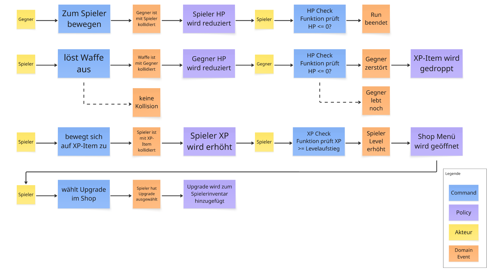
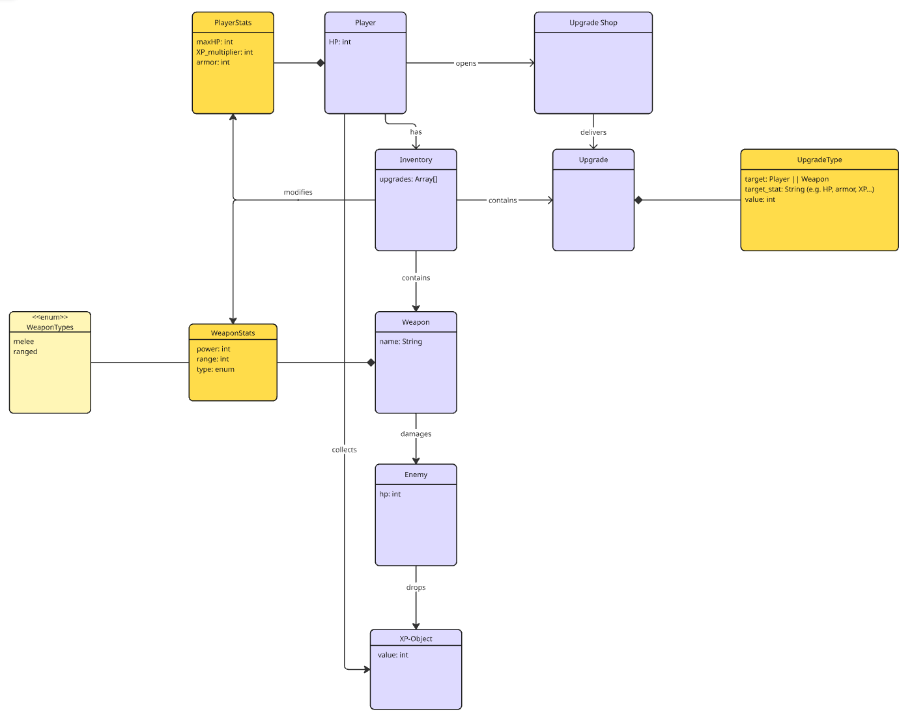
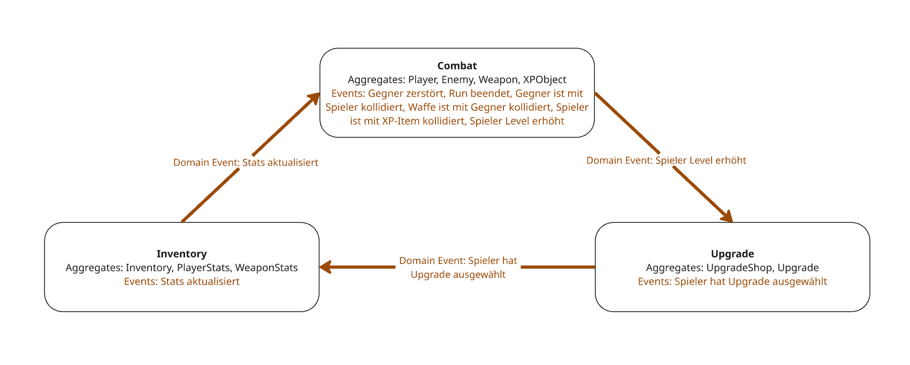
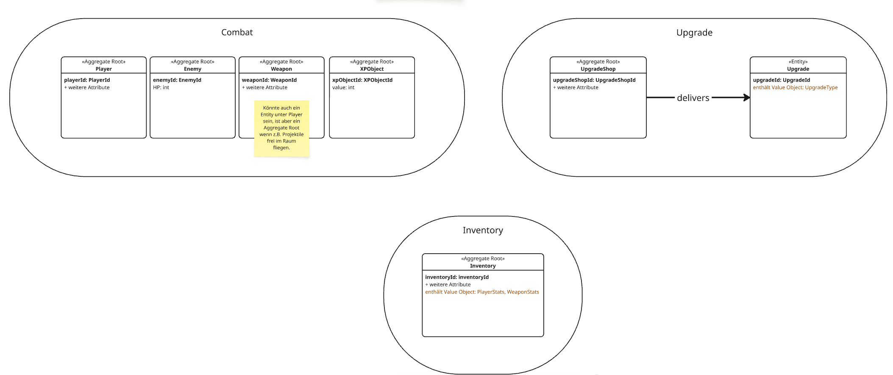

# MSE_Roguelike
Im Rahmen dieses Projekts wird ein 2D-Top-Down-Roguelike mit einem speziellen Fokus auf Techniken der modernen Softwareentwicklung umgesetzt.
Dabei handelt es sich um ein Computerspiel, bei dem Wellen an Gegnern die Spielfigur angreifen, während diese versucht den Gegnern auszuweichen und dabei automatisch Angriffe durchführt.
Mit jeder Welle kann der Spieler Upgrades für seine Waffen und Stats erwerben und so die immer schwierigeren Wellen meistern. Das Ziel ist es möglichst viele Wellen zu überleben. Jeder Spieldurchlauf ist dabei anders, z.B. durch zufällig platzierte Gegner und zufällige Upgrades im Shop.

## Dokumentation
### CI/CD
CI/CD verstehen wir als automatisierten, reproduzierbaren Prozess zum Erstellen neuer Softwareartefakte bzw. Softwarebuilds.
#### Plattform
Wir nutzen GitHub Actions, da die Erstellung der CI/CD Pipeline und dessen Integration in den Entwicklungsprozess durch die direkte Integration in GitHub sehr niedrigschwellig ist. Zudem entfällt durch die Nutzung von GitHub Actions der Bedarf für zusätzliche Infrastruktur, wie z.B. bei Jenkins.

#### Integration in den Workflow
Nach jedem Pull-Request sollen automatisiert Unit-Tests ausgeführt werden, um die Funktionalität der Kernkomponenten sicherzustellen. Diese Pull Requests können erst in den main-Branch gemerged werden, wenn die Tests positiv ausfallen. 

Die Erstellung von Builds bzw. die Kompilierung ist zu diesem Zeitpunkt kein Teil des Workflows, da Python zur Laufzeit interpretiert und nicht vor Programmstart kompiliert wird, wie dies beispielsweise bei Java-Applikationen der Fall wäre. Sollte zu einem späteren Zeitpunkt z.B. das Erstellen einer .exe-Datei geplant sein, könnte dies ebenfalls innerhalb des CI/CD-Prozesses geschehen.

### UML und OOD

#### Eventstorming

Im ersten Schritt haben wir eine Eventstorming-Session durchgeführt und die wichtigsten Events für die Funktionalität des Spiels identifiziert. Das Ergebnis ist der folgenden Abbildung zu entnehmen.



#### Domänenmodell

Auf Basis der Ergebnisse des Eventstormings wurde das Domänenmodell erstellt. Dieses ist in der folgenden Abbildung dargestellt.




#### Bounded Contexts

| Bounded Context | Verantwortung | Events | Aggregates |
| :--- | :--- | :--- | :--- |
| Combat | Bewegung, Kollisionen und den XP-Fortschritt verwalten. Haupt-Spielkomponente. | Events: Gegner zerstört, Run beendet, Gegner ist mit Spieler kollidiert, Waffe ist mit Gegner kollidiert, Spieler ist mit XP-Item kollidiert, Spieler Level erhöht | Player, Enemy, Weapon, XPObject |
| Upgrade | Upgrade-Shop bei Levelaufstieg bereitstellen, Upgrade-Auswahl verwalten | Spieler hat Upgrade ausgewählt | UpgradeShop, Upgrade |
| Inventory | Inventar und daraus resultierende Werteveränderungen verwalten. | Stats aktualisiert | Inventory, PlayerStats, WeaponStats |



#### Entitäten und Aggregates
Die Aggregates sind entkoppelt und synchronisieren ihren Zustand über die Domain Events. Alle benötigten Daten sind also im Event enthalten. 



#### Domain Services und Repositories

##### Services

| Service | Art | Aufgabe | Methoden |
| :--- | :--- | :--- | :--- |
| DamageCalculationService | Domain Service | Fachregel zur Berechnung von Schaden über mehrere Aggregates (`Player`, `Enemy`, `Weapon`) unter Berücksichtigung von `power` und `armor` bei Kollisionen. | `processWeaponCollision(weaponId, enemyId)`<br>`processEnemyCollision(enemyId, playerId)` |
| CombatService | Anwendungsservice | Steuert den Spielablauf: Aktualisiert Stats, verarbeitet eingesammelte XP-Objekte, prüft Levelaufstieg und löst kampfbezogene Events aus(z.B. Gegner zestört, Spieler Level erhöht, Run beendet). | `updateStats(event)`<br>`collectXP(playerId, xpObjectId)` |
| UpgradeShopService | Anwendungsservice | Reagiert auf das "Spieler Level erhöht"-Event, erstellt `Upgrade`-Optionen für den `UpgradeShop`, verarbeitet die Wahl des Upgrades und löst das "Spieler hat Upgrade ausgewählt"-Event aus. | `openShop(event)`<br>`chooseUpgrade(shopId, upgradeId)` |
| InventoryService | Anwendungsservice | Reagiert auf das "Spieler hat Upgrade ausgewählt"-Event, fügt das Upgrade zum `Inventory` hinzu, berechnet die Gesamt-Stats und löst das `Stats aktualisiert`-Event aus. | `addUpgrade(event)` |

##### Repositories

| Repository | Aggregate | Methoden |
| :--- | :--- | :--- |
| **`EnemyRepository`** | `Enemy` | `save(Enemy)`<br>`findById(EnemyId): Optional<Enemy>`<br>`findAllActive(): List<Enemy>`<br>`remove(EnemyId)` |
| **`WeaponRepository`** | `Weapon` | `save(Weapon)`<br>`findById(WeaponId): Optional<Weapon>` |
| **`XPObjectRepository`** | `XPObject` | `save(XPObject)`<br>`remove(XPObjectId)` |

Es gibt kein PlayerRepository, weil es nur einen Player geben kann. Selbes gilt für UpgradeShop und Inventory. Ein gesondertes Repository ist daher nicht nötig. Repositorys werden hier nur implementiert, wenn mehrere Instanzen der Entität bzw. des Aggregates existieren können.

#### Implementierungsstrategie
Die Implementierung erfolgt anhand des Spielzykluses, welcher inkrementell erweitert wird (MVP-Ansatz):
1. Minimaler Kampf-Loop:
    - `Player` und `Enemy` erstellen
    - Kollision reduziert HP bei `Player` und `Enemy`
    - Erstellung von `XPObject`s durch das "Gegner zerstört"-Event
2. Vollständiger Spielzyklus:
    - Auslösen des "Spieler Level erhöht"-Events, sobald genügend `XPObject`s gesammelt wurden
    - Öffnung des `UpgradeShop`s zum neuen Level
    - Auswahl des `Upgrade`s aus dem `UpgradeShop`
    - Berechnung der neuen Stat-Werte mittels des Inventars
3. Steuerung und grafische Darstellung
    - Erst nachdem alle Kernfunktionalitäten in Tests funktionieren, wird die Steuerung und grafische Darstellung implementiert. Dazu gehören z.B. Hitboxen, das Shop-UI und die Steuerung mittels WASD oder Pfeiltasten.

*Modularität & Testbarkeit*: Die Bounded Contexts sind jeweils ein eigenes Python-Paket und kommunizieren ausschließlich mittels Domain-Events und ggf. weiteren definierten Schnittstellen miteinander. Pygame agiert lediglich als Rendering- und Input-Adapter. Pygame-Klassen dürfen nicht in Domänenservices, Entitäten und Aggregate importiert werden.
Durch die Trennung von Pygame und den Einsatz von austauschbaren In-Memory-Repositories lässt sich die gesamte Spiellogik unabhängig mit pytest testen.

*Beispielhafte Umsetzung*:
Value Objects und Domain Events werden als unveränderliche Dataclasses modelliert, während Entities/Aggregates ihre Zustandsänderungen über Methoden kapseln:

```python
# Value Object (unveränderlich)
@dataclass(frozen=True)
class PlayerStats:
    max_hp: int
    armor: int
    xp_multiplier: float = 1.0

    def apply_bonus(self, hp_bonus: int = 0, armor_bonus: int = 0) -> "PlayerStats":
        return replace(self, max_hp=self.max_hp + hp_bonus, armor=self.armor + armor_bonus)

# Aggregate Root
@dataclass
class Player:
    player_id: int
    hp: int = 100
    max_hp: int = 100
    armor: int = 0

    def take_damage(self, raw_damage: int) -> bool:
        effective_damage = max(1, raw_damage - self.armor)
        self.hp = max(0, self.hp - effective_damage)
        return self.hp == 0

# In-Memory-Repository
class InMemoryEnemyRepository:
    def __init__(self) -> None:
        self._enemies: dict[int, Enemy] = {}

    def save(self, enemy: Enemy) -> None:
        self._enemies[enemy.enemy_id] = enemy

    def find_by_id(self, enemy_id: int) -> Enemy | None:
        return self._enemies.get(enemy_id)

    def find_all_active(self) -> list[Enemy]:
        return list(self._enemies.values())

    def remove(self, enemy_id: int) -> None:
        self._enemies.pop(enemy_id, None)

# Domain Service:
class CollisionService:
    def process_weapon_collision(self, weapon: Weapon, enemy: Enemy) -> bool:
        return enemy.take_damage(weapon.power)
```